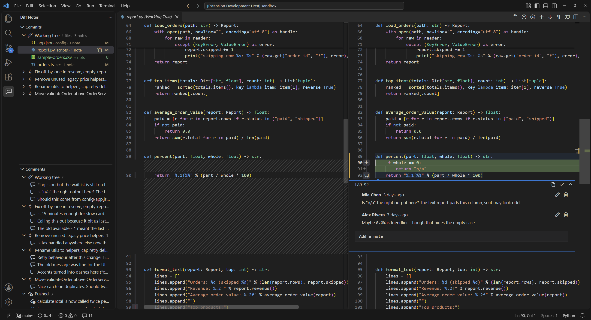
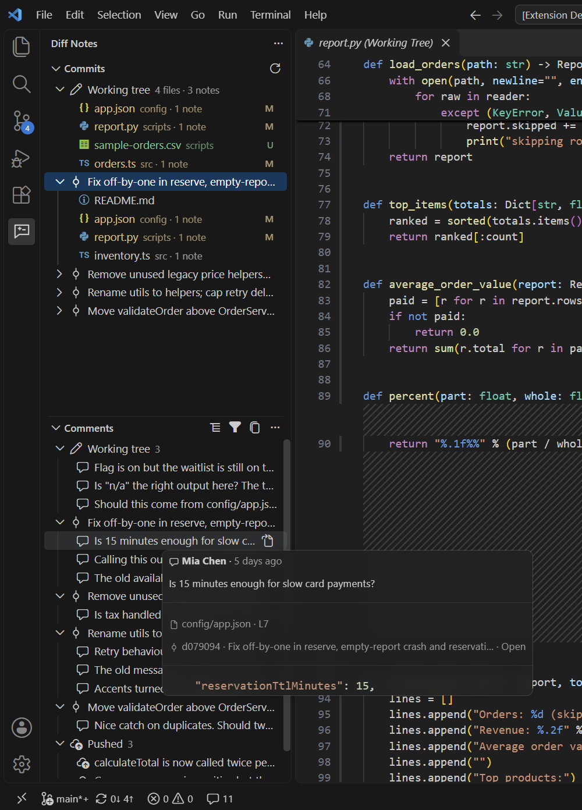

# Diff Notes

Leave PR-style review notes on your own local commits and uncommitted changes, before anything is pushed.

Diff Notes adds comment boxes to VS Code's normal diff editor. Notes are stored inside your repository (in `.git/diff-notes/`), never in your working files, and never leave your machine.

<!-- Screenshot to take: a diff editor with one open note on a changed line, showing the comment box and the gutter marker. -->

## Quick start

1. Open a folder that is a Git repository.
2. Click the **Diff Notes** icon in the activity bar.
3. In **Commits**, open an unpushed commit (or the uncommitted changes) and open a file's diff.
4. Click the `+` next to a line (or select several lines), write your note, and press **Add Note**.
5. Use the **Comments** view to see all notes, jump to them, resolve them, or copy them.

<!-- Screenshot to take: the Diff Notes sidebar with the Commits view (a few commits with note counts) and the Comments view (grouped by commit, with open and resolved notes). -->

## Features

- **Notes on diffs.** Comment on single lines or ranges in commit diffs and in the uncommitted-changes diff. Reply, edit, resolve and reopen. Note text supports markdown.
- **Commits and Comments views.** Commits lists your unpushed commits and uncommitted changes with note counts. Comments lists every note and can show open notes only or resolved ones too.
- **Group by.** Group the Comments view by commit, by file, or not at all.
- **Pushed and outdated tracking.** Notes on commits that have since been pushed move to a Pushed section. Notes whose lines changed move to Outdated, and you can open the current diff from them.
- **Rename following.** If a commented file is renamed, its notes follow it.
- **Previous / next note.** Step through notes in a diff with the title-bar buttons or `Alt+P` / `Alt+N`.
- **Copy as markdown.** Copy all notes, or one group or note, as markdown, ready to paste into a PR description, chat or an AI assistant.
- **Delete and auto-clear.** Delete single notes, or clear all resolved, pushed or outdated notes at once. Optionally delete notes automatically some days after their commit is pushed.
- **Optional pre-push hook.** Lists open notes on the commits you are about to push and asks `Push anyway? [y/N]`. An existing pre-push hook (such as Husky) keeps working.

<!-- Screenshot to take: the pre-push hook prompt in a terminal, showing the list of open notes and the "Push anyway? [y/N]" question. -->

## Settings

| Setting | Default | Description |
| --- | --- | --- |
| `diffNotes.prePushHook` | `false` | Install a git `pre-push` hook in this repository that lists open notes on the commits being pushed and asks `Push anyway? [y/N]`. An existing pre-push hook is kept and runs first. Turning this off removes the hook and restores the previous one. |
| `diffNotes.autoClearPushedDays` | `0` | Automatically delete notes on pushed commits this many days after the commit was first seen as pushed. `0` turns it off. |

## Known limitations

- Notes become Outdated when lines inside their range change.
- Pressing Esc does not close a comment box (a VS Code issue). Use **Cancel**.
- In workspaces with several Git repositories, only the first one is used.
- The uncommitted-changes diff is read-only; you can't edit in place.
- If several unpushed commits match a note's code, the note may attach to the wrong one (the newest wins).
- The pre-push prompt only works when pushing from a terminal. Pushing from an IDE button prints the list of open notes but lets the push go ahead.
- If Husky regenerates its `.husky/_` folder, it overwrites the Diff Notes hook until the extension next starts.
- An unsaved draft note has no gutter marker until it is saved, and empty drafts may stay until their diff tab is closed.
- When copying as markdown, the code block language is guessed from the file extension.

## License

[MIT](LICENSE)
